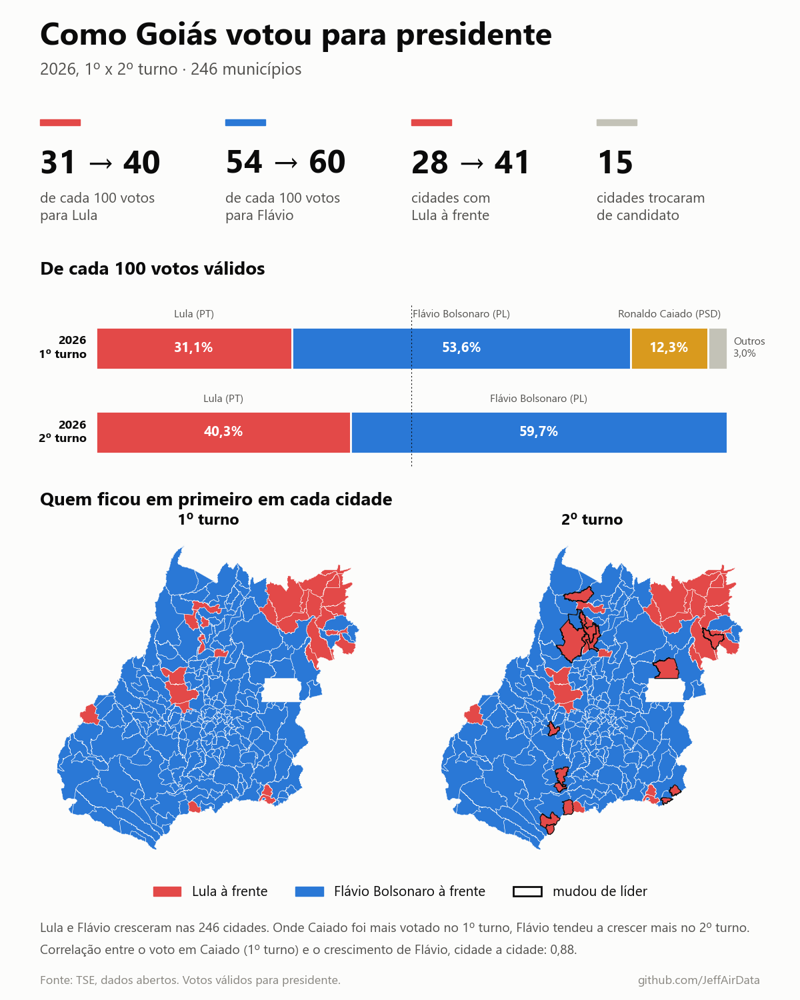
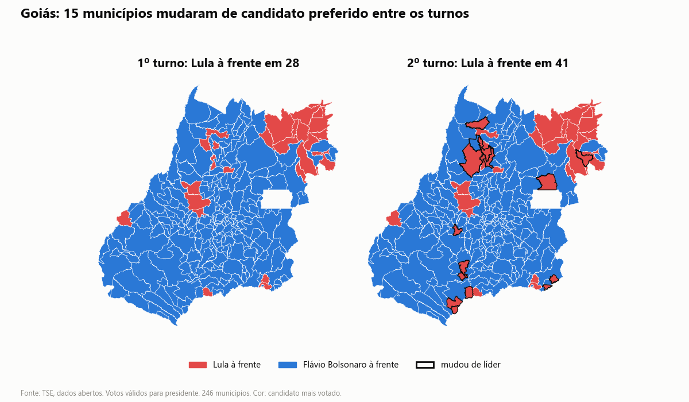
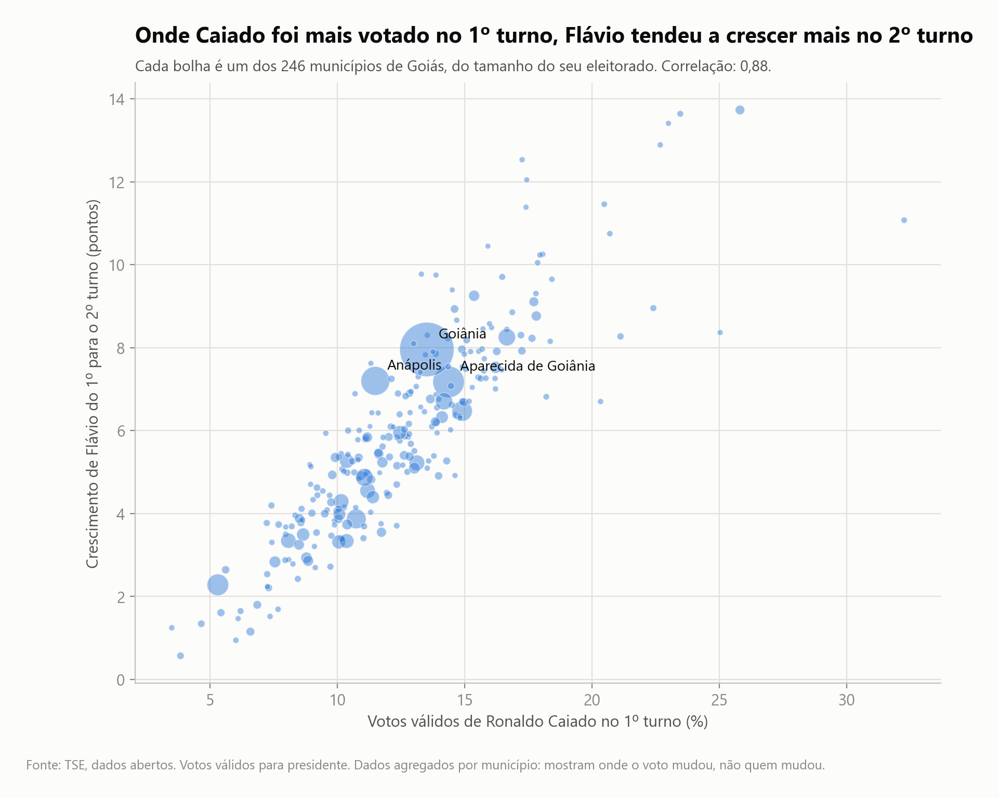
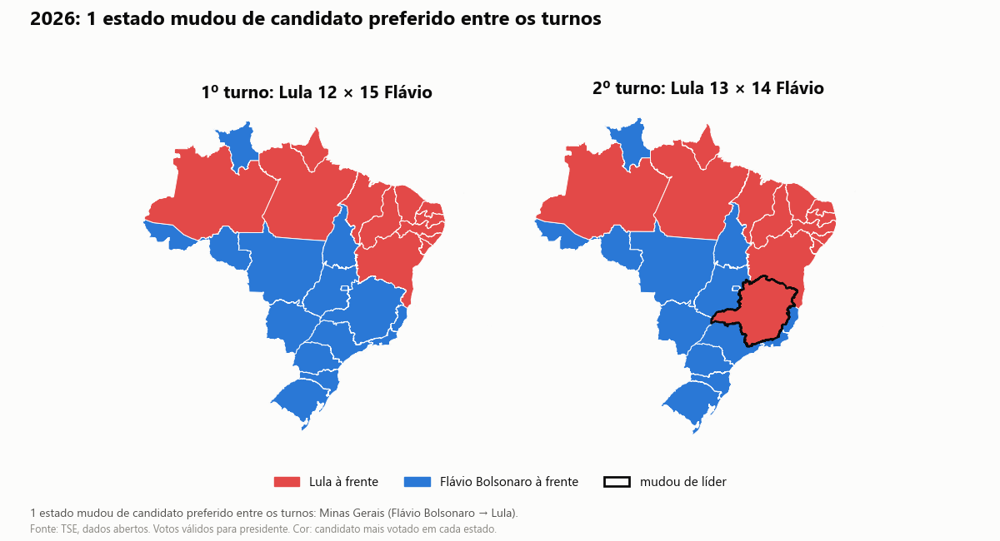
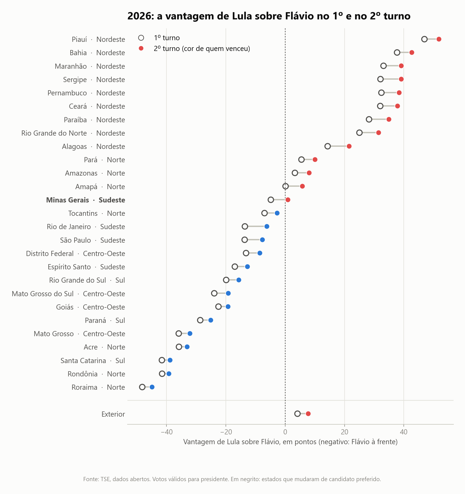
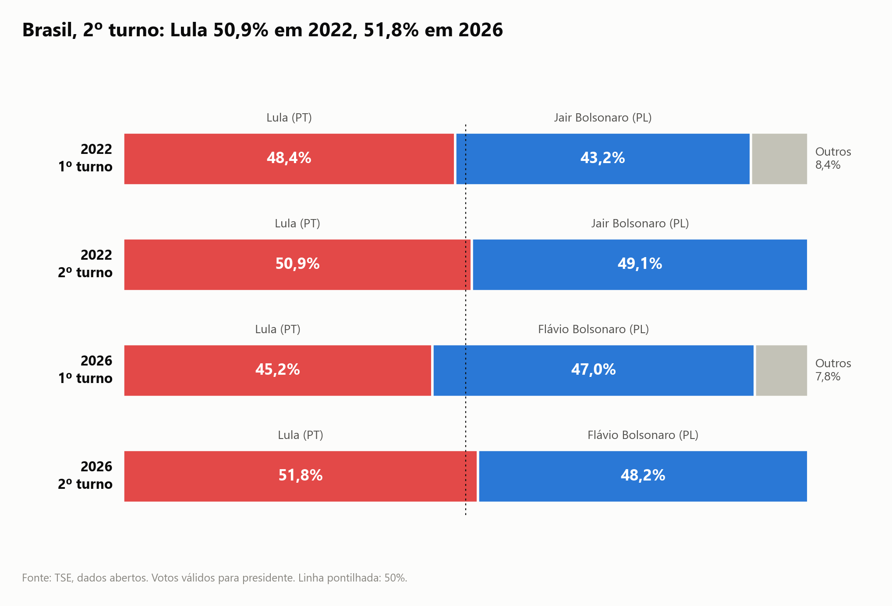
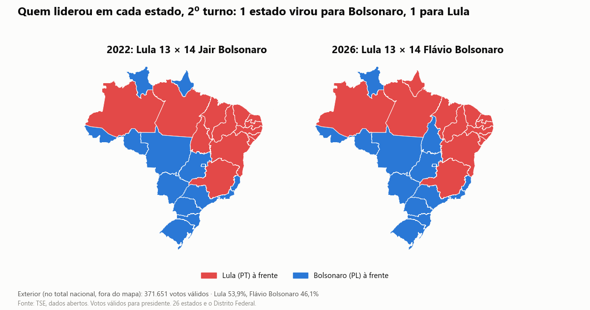
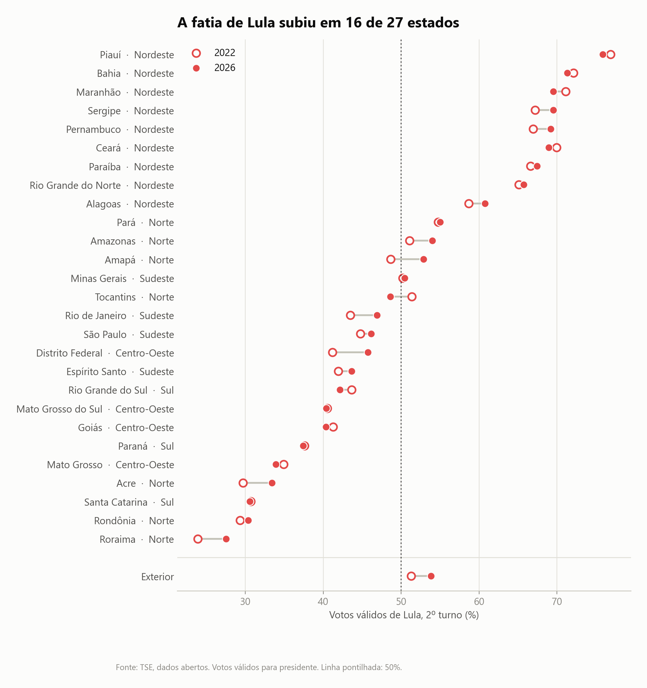

# Como o Brasil votou para presidente: 2022 x 2026

A eleição para presidente de 2026 comparada em três recortes, com os dados abertos do TSE (Tribunal Superior Eleitoral).

👉 **[Abrir a página interativa](https://jeffairdata.github.io/brasil-eleicoes-para-presidente-2022-2026/)**: escolha um estado ou procure uma cidade de Goiás.

## Os três recortes

| | Recorte | Na página | Painel |
|---|---|---|---|
| 1 | **Goiás, município por município:** 1º x 2º turno de 2026 nas 246 cidades | [Parte 3](https://jeffairdata.github.io/brasil-eleicoes-para-presidente-2022-2026/#parte-3) | `docs/img/painel_1_goias.png` |
| 2 | **Brasil, estado por estado:** 1º x 2º turno de 2026, quais estados mudaram de candidato preferido | [Parte 2](https://jeffairdata.github.io/brasil-eleicoes-para-presidente-2022-2026/#parte-2) | `docs/img/painel_2_estados.png` |
| 3 | **2º turno de 2022 x 2º turno de 2026:** Lula contra Jair Bolsonaro e contra Flávio Bolsonaro, no país e por estado | [Parte 1](https://jeffairdata.github.io/brasil-eleicoes-para-presidente-2022-2026/#parte-1) | `docs/img/painel_3_2022x2026.png` |

A numeração segue a série de posts no LinkedIn: começa por Goiás e termina na comparação com 2022.



## Quem é quem

- **Lula** (Luiz Inácio Lula da Silva): PT, esquerda. Presidente de 2003 a 2010 e desde 2023.
- **Jair Bolsonaro**: PL, direita. Presidente de 2019 a 2022; perdeu o 2º turno de 2022 para Lula.
- **Flávio Bolsonaro**: PL, direita. Senador pelo Rio de Janeiro e filho mais velho de Jair; candidato do PL em 2026.
- **Ronaldo Caiado**: PSD. Ex-governador de Goiás; candidato no 1º turno de 2026.

## Os gráficos

Goiás, 1º x 2º turno:




Brasil, 1º x 2º turno de 2026:




2º turno, 2022 x 2026:





Cartões para redes sociais (1080x1080): `card_a1` a `card_a3` (Goiás), `card_b1` a `card_b3` (1º x 2º turno), `card_1` a `card_5` (2022 x 2026), todos em `docs/img/`.

## Como ler os números

- Contam só os **votos válidos**: brancos e nulos ficam de fora.
- Os 27 "estados" são os 26 estados mais o Distrito Federal.
- **Votos no exterior** (nos consulados) entram em todo total nacional, mas não pertencem a nenhum estado: aparecem sempre numa linha à parte, nunca nos mapas.
- **Candidato preferido** é o mais votado no estado ou no município naquele turno.
- Os dados são agregados por lugar. Mostram **onde** o voto mudou, não **quem** mudou de voto. A comparação entre o voto em Caiado e o crescimento de Flávio é uma correlação entre cidades, não uma medida de quantos eleitores de Caiado votaram em Flávio.
- Cores fixas em tudo: vermelho para Lula, azul para Flávio (e Jair) Bolsonaro, amarelo para Caiado e cinza para contagens.

## Conferência com o resultado oficial

`src/check_totals.py` compara os totais nacionais do 2º turno de 2026 com o *Relatório Resultado da Totalização* do TSE: eleitorado apto, comparecimento, abstenção, votos válidos, brancos, nulos e os votos de cada candidato. Os oito números batem, sem diferença.

A abstenção oficial não conta os 423 eleitores aptos de seções que não foram instaladas no exterior, por isso aptos − comparecimento não fecha exatamente com ela. A diferença é desprezível.

---

## Para quem quer os dados

Em `Data/processed/`:

| Arquivo | Conteúdo |
|---|---|
| `president_votes_national` (Parquet, CSV) | votos por candidato, ano e turno |
| `president_votes_state` (Parquet, CSV) | o mesmo, por estado e para o exterior |
| `president_votes_municipality` (Parquet) | o mesmo, por município, com códigos do TSE e do IBGE |
| `turnout_state` (Parquet, CSV) | eleitores aptos, comparecimento, abstenção, brancos e nulos, por estado |
| `turnout_municipality` (Parquet) | o mesmo, por município |
| `summary_goias_rounds_2026.csv` | uma linha por município de Goiás, 1º x 2º turno de 2026 |
| `summary_states_rounds_2026.csv` | uma linha por estado, 1º x 2º turno de 2026 |
| `summary_states_runoff_2022_2026.csv` | uma linha por estado, 2º turno de 2022 x 2026 |

Fontes: [portal de dados abertos do TSE](https://dadosabertos.tse.jus.br/), arquivos `votacao_candidato_munzona` e `detalhe_votacao_munzona`. Mapas: IBGE (estados 2020, municípios 2024), via `geobr`. Correspondência entre códigos de município do TSE e do IBGE: [betafcc/Municipios-Brasileiros-TSE](https://github.com/betafcc/Municipios-Brasileiros-TSE).

### Como reproduzir

```bash
python -m venv .venv
.venv\Scripts\activate          # Linux/Mac: source .venv/bin/activate
pip install -r requirements.txt
python src/download_tse.py      # cerca de 1 GB, em Data/raw/tse/
python src/build_dataset.py     # tabelas em Data/processed/
python src/build_charts.py      # gráficos, cartões, painéis, página (docs/) e posts (publication/)
python src/check_totals.py      # conferência com o relatório oficial do TSE
```

Todo título e todo número dos gráficos, da página e dos posts é calculado a partir dos dados; nada é digitado à mão.

O `check_totals.py` precisa do relatório oficial, que o `download_tse.py` não baixa: salve `Relatorio_Resultado_Totalizacao_2026_BR.zip` (no portal do TSE, em resultados da eleição de 2026) em `Data/raw/tse/relatorio_totalizacao/`.

### Posts

Em `publication/`, um post por recorte, na ordem da série: `post_1_goias_pt.md`, `post_2_estados_pt.md` e `post_3_2022x2026_pt.md`. As versões em inglês virão ao lado, com o sufixo `_en`.

## Projeto anterior

A comparação do **1º turno** de 2022 com o de 2026, em inglês, continua publicada em [brazil-president-election-2022-2026](https://github.com/JeffAirData/brazil-president-election-2022-2026).

## Licença

Código sob a [GNU GPL v3](LICENSE). Os dados de origem são públicos, do TSE e do IBGE.
